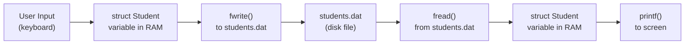
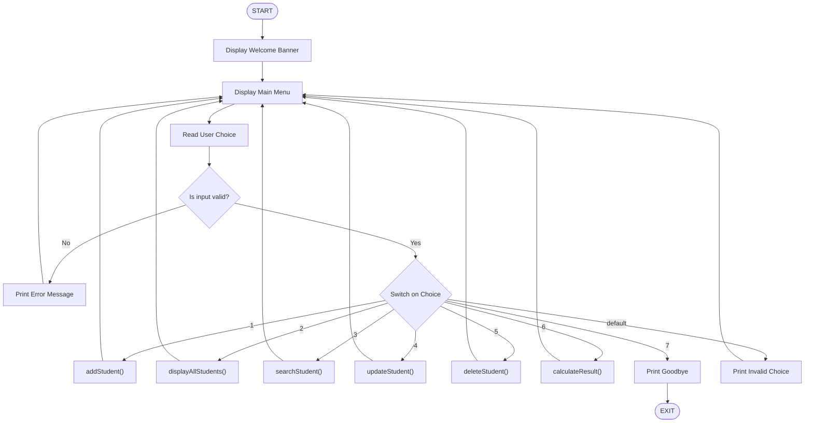
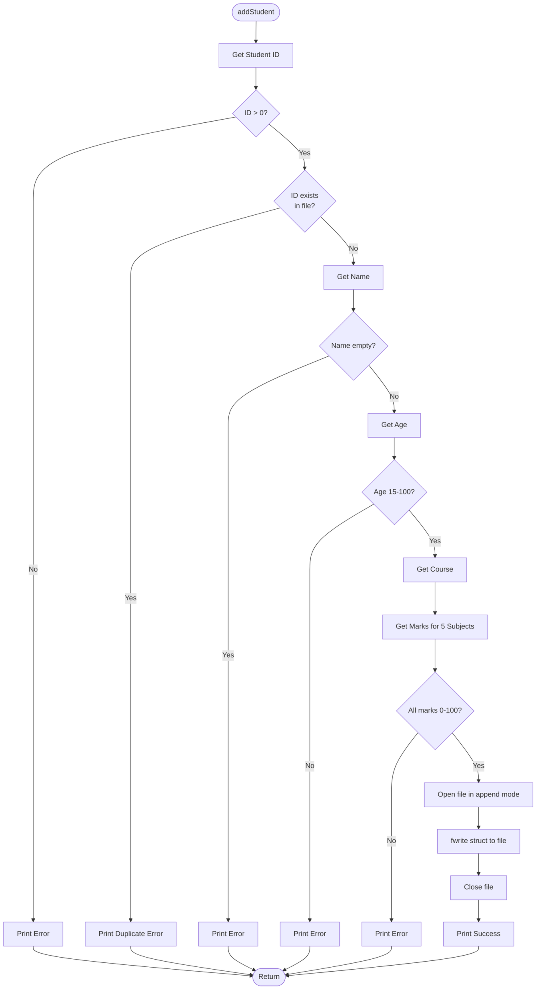
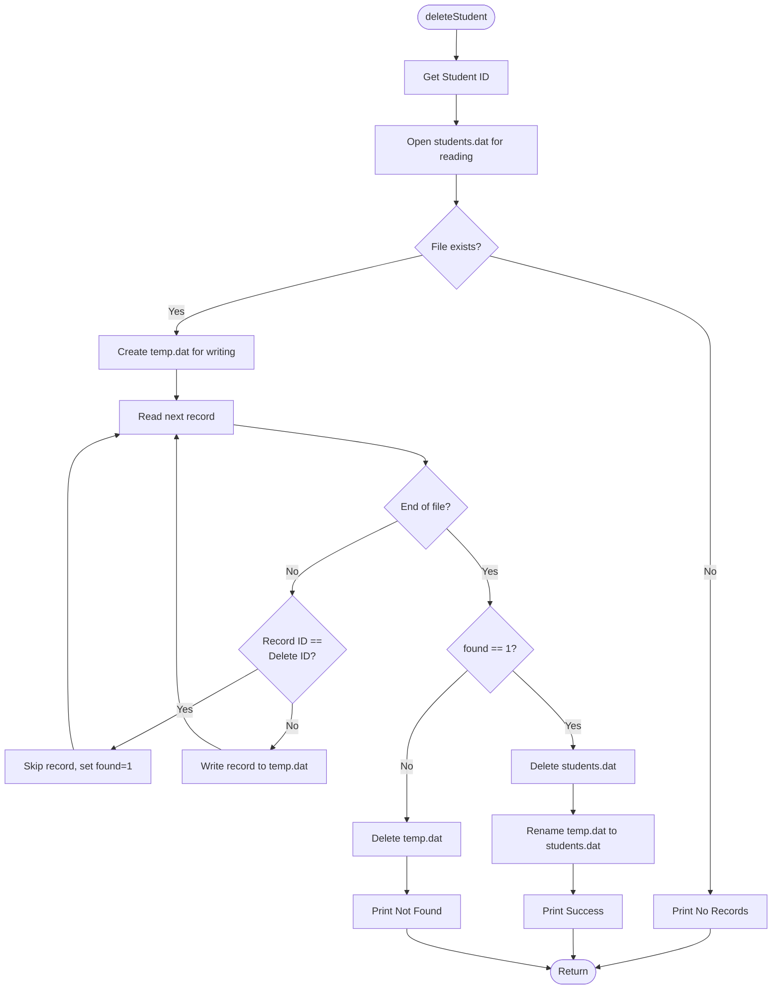
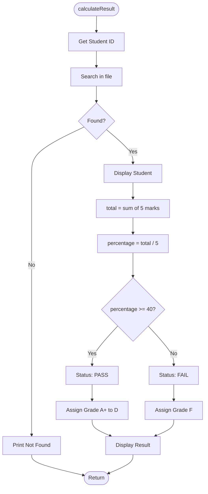

# 📘 Student Management System — Complete Project Report

## College Mini Project in C Programming

---

## Table of Contents

1. [Project Introduction & Objective](#1-project-introduction--objective)
2. [Complete Source Code](#2-complete-source-code)
3. [Line-by-Line Code Explanation](#3-line-by-line-code-explanation)
4. [Function-by-Function Explanation](#4-function-by-function-explanation)
5. [How Structures & File Handling Work](#5-how-structures--file-handling-work)
6. [Sample Input & Output](#6-sample-input--output)
7. [How to Compile & Run in VS Code](#7-how-to-compile--run-in-vs-code)
8. [Project Flowchart](#8-project-flowchart)
9. [Algorithm](#9-algorithm)
10. [Viva Questions & Answers (20+)](#10-viva-questions--answers)
11. [Project Report Format](#11-project-report-format)

---

## 1. Project Introduction & Objective

### Introduction

The **Student Management System** is a console-based application written in the C programming language. It provides a simple and efficient way to manage student records — including adding, viewing, searching, updating, and deleting student data. All records are stored permanently in a binary file on disk, so data persists even after the program is closed.

This project is designed as a **first-year college practical examination** mini project. It demonstrates fundamental C programming concepts such as structures, functions, loops, conditional statements, arrays, string handling, and file I/O, all wrapped in a clean, menu-driven interface.

### Objectives

| # | Objective |
|---|-----------|
| 1 | Build a fully functional student record management system in C. |
| 2 | Demonstrate the use of structures to group related data. |
| 3 | Implement file handling to store records permanently. |
| 4 | Practice modular programming by dividing code into functions. |
| 5 | Provide input validation for a robust user experience. |
| 6 | Calculate academic results (total, percentage, grade, pass/fail). |
| 7 | Create a clean, menu-driven console interface. |

---

## 2. Complete Source Code

> [!NOTE]
> The full source code is saved at [student_management.c](file:///c:/Users/ASUS/OneDrive/Desktop/ANTI/student_management.c).

The source code is approximately **370 lines** and is organized into the following sections:

| Section | Lines (approx.) | Description |
|---------|-----------------|-------------|
| Header includes & constants | 1–20 | Library imports and `#define` constants |
| Structure definition | 22–30 | `struct Student` with 5 fields |
| Function prototypes | 32–42 | Forward declarations of all functions |
| `main()` | 44–90 | Menu loop and switch-case dispatcher |
| `displayMenu()` | 92–105 | Prints the 7-option menu |
| `clearInputBuffer()` | 107–115 | Flushes leftover input characters |
| `isIdExists()` | 117–137 | Checks for duplicate student IDs |
| `displayOneStudent()` | 139–155 | Formats and prints one student record |
| `addStudent()` | 157–220 | Collects data and appends to file |
| `displayAllStudents()` | 222–252 | Reads and prints every record |
| `searchStudent()` | 254–290 | Finds a student by ID |
| `updateStudent()` | 292–365 | Modifies an existing record in-place |
| `deleteStudent()` | 367–420 | Removes a record using a temp file |
| `calculateResult()` | 422–485 | Computes total, percentage, grade |

---

## 3. Line-by-Line Code Explanation

### 3.1 Header Files and Constants

```c
#include <stdio.h>      /* For input/output functions       */
#include <stdlib.h>     /* For exit() function               */
#include <string.h>     /* For string handling functions      */
```

- **`stdio.h`** — Provides `printf()`, `scanf()`, `fgets()`, `fopen()`, `fclose()`, `fread()`, `fwrite()`, `getchar()`, `fseek()`, `remove()`, `rename()`.
- **`stdlib.h`** — Provides the `exit()` function to terminate the program.
- **`string.h`** — Provides `strlen()` and `strcspn()` for string processing.

```c
#define MAX_NAME     50
#define MAX_COURSE   50
#define NUM_SUBJECTS  5
#define FILENAME     "students.dat"
```

- `MAX_NAME` — Maximum characters allowed in a student name (50).
- `MAX_COURSE` — Maximum characters in a course name (50).
- `NUM_SUBJECTS` — Each student has marks for 5 subjects.
- `FILENAME` — The binary data file where records are stored.

### 3.2 Structure Definition

```c
struct Student {
    int   id;
    char  name[MAX_NAME];
    int   age;
    char  course[MAX_COURSE];
    float marks[NUM_SUBJECTS];
};
```

This creates a **user-defined data type** called `struct Student`. Each variable of this type holds:

| Field | Type | Purpose |
|-------|------|---------|
| `id` | `int` | Unique identifier for each student |
| `name` | `char[50]` | Student's full name |
| `age` | `int` | Student's age |
| `course` | `char[50]` | Name of the course/program |
| `marks` | `float[5]` | Array of marks for 5 subjects |

### 3.3 Function Prototypes

```c
void displayMenu(void);
void addStudent(void);
void displayAllStudents(void);
void searchStudent(void);
void updateStudent(void);
void deleteStudent(void);
void calculateResult(void);
int  isIdExists(int id);
void displayOneStudent(struct Student s);
void clearInputBuffer(void);
```

These are **forward declarations**. They tell the compiler: "These functions will be defined later in the code." This allows `main()` to call them even though they appear after `main()` in the source file.

### 3.4 The `main()` Function

```c
int main(void) {
    int choice;
```

- Declares an integer variable `choice` to store the user's menu selection.

```c
    while (1) {
        displayMenu();
```

- `while(1)` creates an **infinite loop** — the menu keeps appearing until the user picks option 7 (Exit).
- `displayMenu()` prints the 7 options.

```c
        if (scanf("%d", &choice) != 1) {
            printf("...[ERROR]...\n");
            clearInputBuffer();
            continue;
        }
        clearInputBuffer();
```

- `scanf("%d", &choice)` reads an integer from the keyboard.
- If the user types a letter instead of a number, `scanf` returns `0` (not `1`), so we print an error.
- `clearInputBuffer()` eats any leftover characters (like the newline `\n` from pressing Enter).
- `continue` jumps back to the top of the loop without executing the switch.

```c
        switch (choice) {
            case 1: addStudent();         break;
            case 2: displayAllStudents(); break;
            case 3: searchStudent();      break;
            case 4: updateStudent();      break;
            case 5: deleteStudent();      break;
            case 6: calculateResult();    break;
            case 7:
                printf("...Goodbye!\n");
                exit(0);
            default:
                printf("...[ERROR]...\n");
        }
```

- The `switch` statement checks the value of `choice` and calls the matching function.
- `break` prevents "fall-through" (running the next case).
- `exit(0)` safely terminates the entire program.
- `default` handles any number outside 1–7.

### 3.5 Input Buffer Clearing

```c
void clearInputBuffer(void) {
    int c;
    while ((c = getchar()) != '\n' && c != EOF)
        ;
}
```

- `getchar()` reads one character at a time from the input buffer.
- The loop keeps reading until it hits a newline (`\n`) or end-of-file (`EOF`).
- **Why is this needed?** When `scanf("%d")` reads a number, it leaves the `\n` (Enter key) in the buffer. If we then call `fgets()`, it would read that leftover `\n` as an empty string. This function clears that problem.

### 3.6 Writing to File (in `addStudent`)

```c
    fp = fopen(FILENAME, "ab");
    fwrite(&s, sizeof(struct Student), 1, fp);
    fclose(fp);
```

- `fopen(FILENAME, "ab")` opens the file in **append-binary** mode:
  - `a` = append (new data goes to the end, existing data is preserved)
  - `b` = binary (the struct is written as raw bytes)
- `fwrite(&s, sizeof(struct Student), 1, fp)` writes the entire struct `s` as one block of bytes.
- `fclose(fp)` saves and closes the file.

### 3.7 Reading from File (in `displayAllStudents`)

```c
    fp = fopen(FILENAME, "rb");
    while (fread(&s, sizeof(struct Student), 1, fp) == 1) {
        displayOneStudent(s);
        count++;
    }
    fclose(fp);
```

- `fopen(FILENAME, "rb")` opens in **read-binary** mode.
- `fread(&s, sizeof(struct Student), 1, fp)` reads one struct-sized block of bytes from the file into `s`.
- The `while` loop keeps reading until `fread` returns `0` (no more records).

### 3.8 Updating a Record (in `updateStudent`)

```c
    fseek(fp, -(long)sizeof(struct Student), SEEK_CUR);
    fwrite(&s, sizeof(struct Student), 1, fp);
```

- After reading the record (which advances the file pointer past it), `fseek()` moves the pointer **backward** by exactly one record size.
- Then `fwrite()` overwrites the old record with the updated data at the same position.

### 3.9 Deleting a Record (in `deleteStudent`)

```c
    temp = fopen("temp.dat", "wb");
    while (fread(&s, sizeof(struct Student), 1, fp) == 1) {
        if (s.id == deleteId) {
            found = 1;  /* skip this record */
        } else {
            fwrite(&s, sizeof(struct Student), 1, temp);
        }
    }
    remove(FILENAME);
    rename("temp.dat", FILENAME);
```

- A temporary file `temp.dat` is created.
- Every record **except** the one to delete is copied to `temp.dat`.
- The original file is deleted, and `temp.dat` is renamed to the original filename.
- This is the standard file-based deletion technique in C.

### 3.10 Calculating Results

```c
    total = 0;
    for (i = 0; i < NUM_SUBJECTS; i++) {
        total = total + s.marks[i];
    }
    percentage = total / (float)NUM_SUBJECTS;
```

- Loops through the 5 marks, adding each to `total`.
- Percentage = total ÷ 5 (since each subject is out of 100, dividing by 5 gives percentage).
- `(float)NUM_SUBJECTS` ensures floating-point division (not integer division).

```c
    if (percentage >= 90.0)       printf("Grade: A+\n");
    else if (percentage >= 80.0)  printf("Grade: A\n");
    else if (percentage >= 70.0)  printf("Grade: B\n");
    else if (percentage >= 60.0)  printf("Grade: C\n");
    else if (percentage >= 40.0)  printf("Grade: D\n");
    else                          printf("Grade: F\n");
```

- An if-else ladder assigns a letter grade based on percentage ranges.

---

## 4. Function-by-Function Explanation

### 4.1 `main()`
| Property | Detail |
|----------|--------|
| **Purpose** | Entry point. Runs the menu loop and dispatches to other functions. |
| **Parameters** | None |
| **Returns** | `int` (0 for success) |
| **Key Logic** | `while(1)` infinite loop + `switch(choice)` for menu selection. |

### 4.2 `displayMenu()`
| Property | Detail |
|----------|--------|
| **Purpose** | Prints the 7 menu options on the console. |
| **Parameters** | None |
| **Returns** | Nothing (`void`) |
| **Key Logic** | Sequential `printf()` statements. |

### 4.3 `clearInputBuffer()`
| Property | Detail |
|----------|--------|
| **Purpose** | Clears leftover characters from the keyboard input buffer. |
| **Parameters** | None |
| **Returns** | Nothing (`void`) |
| **Key Logic** | `while` loop calling `getchar()` until `\n` or `EOF`. |
| **Why Needed** | Prevents `fgets()` from reading a stale newline after `scanf()`. |

### 4.4 `isIdExists(int id)`
| Property | Detail |
|----------|--------|
| **Purpose** | Checks if a student ID already exists in the data file. |
| **Parameters** | `int id` — the ID to check. |
| **Returns** | `1` if found, `0` if not. |
| **Key Logic** | Opens file in `"rb"` mode, reads records with `fread()`, compares each `s.id` with `id`. |

### 4.5 `displayOneStudent(struct Student s)`
| Property | Detail |
|----------|--------|
| **Purpose** | Prints all fields of a single student in a formatted box. |
| **Parameters** | `struct Student s` — the student to display (passed by value). |
| **Returns** | Nothing (`void`) |
| **Key Logic** | `printf()` for each field + a `for` loop for the 5 marks. |

### 4.6 `addStudent()`
| Property | Detail |
|----------|--------|
| **Purpose** | Collects student details from the user and appends them to the file. |
| **Parameters** | None |
| **Returns** | Nothing (`void`) |
| **Key Logic** | 1) `scanf` for ID → validate uniqueness with `isIdExists()`. 2) `fgets` for name. 3) `scanf` for age → validate range. 4) `fgets` for course. 5) `scanf` loop for 5 marks → validate 0–100. 6) `fopen("ab")` + `fwrite()` to save. |
| **Validation** | ID > 0, ID unique, name non-empty, age 15–100, course non-empty, marks 0–100. |

### 4.7 `displayAllStudents()`
| Property | Detail |
|----------|--------|
| **Purpose** | Reads every record from the file and displays them all. |
| **Parameters** | None |
| **Returns** | Nothing (`void`) |
| **Key Logic** | `fopen("rb")` → `while(fread(...))` loop → `displayOneStudent()` → show total count. |

### 4.8 `searchStudent()`
| Property | Detail |
|----------|--------|
| **Purpose** | Finds a student by ID and displays their record. |
| **Parameters** | None |
| **Returns** | Nothing (`void`) |
| **Key Logic** | Reads records one by one; if `s.id == searchId`, display and `break`. Uses a `found` flag. |

### 4.9 `updateStudent()`
| Property | Detail |
|----------|--------|
| **Purpose** | Modifies an existing student's name, age, course, and marks. |
| **Parameters** | None |
| **Returns** | Nothing (`void`) |
| **Key Logic** | Opens file in `"r+b"` (read+write). Finds the record, collects new data, uses `fseek()` to rewind one record, then `fwrite()` to overwrite in place. |

### 4.10 `deleteStudent()`
| Property | Detail |
|----------|--------|
| **Purpose** | Removes a student record from the file. |
| **Parameters** | None |
| **Returns** | Nothing (`void`) |
| **Key Logic** | Copies all records *except* the target to `temp.dat`. Deletes original file with `remove()`. Renames `temp.dat` to original with `rename()`. |

### 4.11 `calculateResult()`
| Property | Detail |
|----------|--------|
| **Purpose** | Computes total marks, percentage, pass/fail, and letter grade. |
| **Parameters** | None |
| **Returns** | Nothing (`void`) |
| **Key Logic** | Sums the 5 marks → divides by 5 for percentage → if-else ladder for grade (A+ through F) → pass if ≥ 40%. |

---

## 5. How Structures & File Handling Work

### 5.1 Structures

A **structure** (`struct`) in C is a way to group multiple related variables under a single name. Think of it as creating your own custom data type.

**Without a structure** you would need separate arrays:
```c
int   ids[100];
char  names[100][50];
int   ages[100];
/* ... messy and error-prone */
```

**With a structure**, everything for one student stays together:
```c
struct Student {
    int   id;
    char  name[50];
    int   age;
    char  course[50];
    float marks[5];
};
```

**How we use it in this project:**
```c
struct Student s;       /* Declare a variable of type struct Student */
s.id = 101;             /* Access the 'id' field using dot (.) operator */
s.marks[0] = 85.5;      /* Access the first subject mark */
```

**Key points:**
- The `.` (dot) operator accesses fields: `s.name`, `s.age`, etc.
- `sizeof(struct Student)` gives the total size in bytes of one record — this is exactly how many bytes `fwrite` writes and `fread` reads.
- Structures can be passed to functions (like `displayOneStudent(s)`).

### 5.2 File Handling

This project uses **binary file handling** to save and load student records.

#### File Modes Used

| Mode | Meaning | Used In |
|------|---------|---------|
| `"rb"` | Read Binary — open for reading only | `displayAllStudents`, `searchStudent`, `isIdExists`, `calculateResult`, `deleteStudent` |
| `"ab"` | Append Binary — open for writing at the end | `addStudent` |
| `"r+b"` | Read+Write Binary — open for both reading and writing | `updateStudent` |
| `"wb"` | Write Binary — create/overwrite for writing | `deleteStudent` (temp file) |

#### Core File Functions

| Function | What It Does | Example |
|----------|-------------|---------|
| `fopen(name, mode)` | Opens a file and returns a pointer | `fp = fopen("students.dat", "rb");` |
| `fclose(fp)` | Closes the file and flushes data | `fclose(fp);` |
| `fwrite(&data, size, count, fp)` | Writes raw bytes to the file | `fwrite(&s, sizeof(struct Student), 1, fp);` |
| `fread(&data, size, count, fp)` | Reads raw bytes from the file | `fread(&s, sizeof(struct Student), 1, fp);` |
| `fseek(fp, offset, origin)` | Moves the file pointer to a position | `fseek(fp, -sizeof(struct Student), SEEK_CUR);` |
| `remove(name)` | Deletes a file from disk | `remove("students.dat");` |
| `rename(old, new)` | Renames a file | `rename("temp.dat", "students.dat");` |

#### How Data Flows



#### Why Binary Files?

- **Simplicity**: One `fwrite()` saves the entire struct; one `fread()` loads it back.
- **Speed**: No need to convert numbers to text and back.
- **Exact Size**: Each record is exactly `sizeof(struct Student)` bytes, making `fseek()` calculations easy.
- **Trade-off**: The file is not human-readable (you can't open it in Notepad and read it).

---

## 6. Sample Input & Output

### 6.1 Starting the Program

```
  =========================================
     STUDENT MANAGEMENT SYSTEM
     College Mini Project in C
  =========================================

  -----------------------------------------
               MAIN MENU
  -----------------------------------------
   1. Add Student
   2. Display All Students
   3. Search Student
   4. Update Student
   5. Delete Student
   6. Calculate Result
   7. Exit
  -----------------------------------------
  Enter your choice (1-7):
```

### 6.2 Adding a Student (Option 1)

```
  Enter your choice (1-7): 1

  ===== ADD NEW STUDENT =====
  Enter Student ID (positive number): 101
  Enter Student Name: Rahul Sharma
  Enter Age (15-100): 19
  Enter Course Name: Computer Science
  Enter marks for 5 subjects (0 to 100 each):
    Subject 1: 85
    Subject 2: 78
    Subject 3: 92
    Subject 4: 65
    Subject 5: 88

  [SUCCESS] Student record added successfully!
```

### 6.3 Adding a Second Student

```
  Enter your choice (1-7): 1

  ===== ADD NEW STUDENT =====
  Enter Student ID (positive number): 102
  Enter Student Name: Priya Patel
  Enter Age (15-100): 18
  Enter Course Name: Electronics
  Enter marks for 5 subjects (0 to 100 each):
    Subject 1: 45
    Subject 2: 32
    Subject 3: 55
    Subject 4: 28
    Subject 5: 38

  [SUCCESS] Student record added successfully!
```

### 6.4 Displaying All Students (Option 2)

```
  Enter your choice (1-7): 2

  ===== ALL STUDENT RECORDS =====

  +-------------------------------+
  | Student ID   : 101            |
  | Name         : Rahul Sharma   |
  | Age          : 19             |
  | Course       : Computer Science |
  | Marks:                        |
  |   Subject 1  : 85.00          |
  |   Subject 2  : 78.00          |
  |   Subject 3  : 92.00          |
  |   Subject 4  : 65.00          |
  |   Subject 5  : 88.00          |
  +-------------------------------+

  +-------------------------------+
  | Student ID   : 102            |
  | Name         : Priya Patel    |
  | Age          : 18             |
  | Course       : Electronics    |
  | Marks:                        |
  |   Subject 1  : 45.00          |
  |   Subject 2  : 32.00          |
  |   Subject 3  : 55.00          |
  |   Subject 4  : 28.00          |
  |   Subject 5  : 38.00          |
  +-------------------------------+

  Total students found: 2
```

### 6.5 Searching a Student (Option 3)

```
  Enter your choice (1-7): 3

  ===== SEARCH STUDENT =====
  Enter Student ID to search: 101

  [FOUND] Student record:

  +-------------------------------+
  | Student ID   : 101            |
  | Name         : Rahul Sharma   |
  | Age          : 19             |
  | Course       : Computer Science |
  | Marks:                        |
  |   Subject 1  : 85.00          |
  |   Subject 2  : 78.00          |
  |   Subject 3  : 92.00          |
  |   Subject 4  : 65.00          |
  |   Subject 5  : 88.00          |
  +-------------------------------+
```

### 6.6 Calculating Result (Option 6)

**For Rahul (ID 101) — PASS:**
```
  Enter your choice (1-7): 6

  ===== CALCULATE RESULT =====
  Enter Student ID: 101

  ...student details shown...

  ========== RESULT ==========
  Student Name  : Rahul Sharma
  Total Marks   : 408.00 / 500
  Percentage    : 81.60%
  Status        : PASS
  Grade         : A  (Excellent)
  ==============================
```

**For Priya (ID 102) — FAIL:**
```
  Enter your choice (1-7): 6

  ===== CALCULATE RESULT =====
  Enter Student ID: 102

  ...student details shown...

  ========== RESULT ==========
  Student Name  : Priya Patel
  Total Marks   : 198.00 / 500
  Percentage    : 39.60%
  Status        : FAIL
  Grade         : F  (Fail)
  ==============================
```

### 6.7 Updating a Student (Option 4)

```
  Enter your choice (1-7): 4

  ===== UPDATE STUDENT =====
  Enter Student ID to update: 102

  Current record:
  ...current details shown...

  Enter new details:
  Enter New Name: Priya Patel
  Enter New Age (15-100): 18
  Enter New Course: Electronics
  Enter new marks for 5 subjects:
    Subject 1: 72
    Subject 2: 65
    Subject 3: 80
    Subject 4: 55
    Subject 5: 68

  [SUCCESS] Student record updated successfully!
```

### 6.8 Deleting a Student (Option 5)

```
  Enter your choice (1-7): 5

  ===== DELETE STUDENT =====
  Enter Student ID to delete: 102

  Deleting the following student:
  ...student details shown...

  [SUCCESS] Student record deleted successfully!
```

### 6.9 Input Validation Examples

```
  Enter Student ID (positive number): -5
  [ERROR] Invalid ID! Must be a positive number.

  Enter Student ID (positive number): 101
  [ERROR] Student ID 101 already exists!

  Enter Age (15-100): 200
  [ERROR] Invalid age! Must be between 15 and 100.

  Enter your choice (1-7): abc
  [ERROR] Invalid input! Please enter a number.

  Enter your choice (1-7): 9
  [ERROR] Invalid choice! Enter a number between 1 and 7.
```

### 6.10 Exiting (Option 7)

```
  Enter your choice (1-7): 7

  Thank you for using Student Management System!
  Exiting... Goodbye!
```

---

## 7. How to Compile & Run in VS Code

### Step 1: Install Prerequisites

1. **Install VS Code**: Download from [https://code.visualstudio.com](https://code.visualstudio.com)
2. **Install MinGW (GCC for Windows)**:
   - Download from [https://sourceforge.net/projects/mingw/](https://sourceforge.net/projects/mingw/) or use MSYS2.
   - During installation, select **gcc** (C compiler).
   - Add MinGW's `bin` folder (e.g., `C:\MinGW\bin`) to your system **PATH** environment variable.
3. **Install the C/C++ Extension** in VS Code:
   - Open VS Code → Extensions (Ctrl+Shift+X) → Search "C/C++" → Install the one by Microsoft.

### Step 2: Verify GCC Installation

Open a terminal (Command Prompt or PowerShell) and run:
```
gcc --version
```
You should see output like `gcc (MinGW.org GCC Build-2) 9.2.0` or similar.

### Step 3: Open the Project

1. Open VS Code.
2. Go to **File → Open Folder** → select the folder containing `student_management.c`.
3. Open the file `student_management.c` in the editor.

### Step 4: Compile

Open the VS Code integrated terminal (**Terminal → New Terminal** or `` Ctrl+` ``) and run:

```
gcc student_management.c -o student_management.exe -Wall
```

| Flag | Meaning |
|------|---------|
| `gcc` | The GNU C Compiler |
| `student_management.c` | Your source file |
| `-o student_management.exe` | Name of the output executable |
| `-Wall` | Enable all common warnings (helps find bugs) |

If there are no errors, the file `student_management.exe` will be created.

### Step 5: Run

In the same terminal, run:

```
./student_management.exe
```

Or on Windows Command Prompt:
```
student_management.exe
```

### Step 6: Interact

The menu will appear. Type a number (1–7) and press Enter to use each feature.

> [!TIP]
> If you get a "gcc not recognized" error, make sure MinGW's `bin` directory is in your system PATH, then restart VS Code.

---

## 8. Project Flowchart

### 8.1 Main Program Flow



### 8.2 Add Student Flow



### 8.3 Delete Student Flow



### 8.4 Calculate Result Flow



---

## 9. Algorithm

### 9.1 Main Algorithm

```
ALGORITHM: Student Management System

Step 1:  START
Step 2:  Display welcome banner
Step 3:  REPEAT
Step 4:      Display main menu (7 options)
Step 5:      Read user choice
Step 6:      IF choice is not a valid number THEN
Step 7:          Print error message
Step 8:          Go to Step 3
Step 9:      END IF
Step 10:     SWITCH (choice)
Step 11:         CASE 1: Call addStudent()
Step 12:         CASE 2: Call displayAllStudents()
Step 13:         CASE 3: Call searchStudent()
Step 14:         CASE 4: Call updateStudent()
Step 15:         CASE 5: Call deleteStudent()
Step 16:         CASE 6: Call calculateResult()
Step 17:         CASE 7: Print goodbye message, EXIT program
Step 18:         DEFAULT: Print invalid choice error
Step 19:     END SWITCH
Step 20: UNTIL user selects Exit (choice = 7)
Step 21: STOP
```

### 9.2 Add Student Algorithm

```
ALGORITHM: addStudent()

Step 1:  Read student ID from user
Step 2:  IF ID <= 0 THEN print error, RETURN
Step 3:  IF ID already exists in file THEN print error, RETURN
Step 4:  Read student name from user
Step 5:  IF name is empty THEN print error, RETURN
Step 6:  Read student age from user
Step 7:  IF age < 15 OR age > 100 THEN print error, RETURN
Step 8:  Read course name from user
Step 9:  IF course is empty THEN print error, RETURN
Step 10: FOR i = 1 TO 5
Step 11:     Read marks for subject i
Step 12:     IF marks < 0 OR marks > 100 THEN print error, RETURN
Step 13: END FOR
Step 14: Open file "students.dat" in append-binary mode
Step 15: Write the student structure to the file
Step 16: Close the file
Step 17: Print success message
Step 18: RETURN
```

### 9.3 Display All Students Algorithm

```
ALGORITHM: displayAllStudents()

Step 1:  Open file "students.dat" in read-binary mode
Step 2:  IF file does not exist THEN print "no records", RETURN
Step 3:  SET count = 0
Step 4:  WHILE (read one student record from file is successful)
Step 5:      Display the student record
Step 6:      count = count + 1
Step 7:  END WHILE
Step 8:  Close the file
Step 9:  IF count == 0 THEN print "no records"
Step 10: ELSE print "Total students: count"
Step 11: RETURN
```

### 9.4 Search Student Algorithm

```
ALGORITHM: searchStudent()

Step 1:  Read search ID from user
Step 2:  Open file in read-binary mode
Step 3:  IF file does not exist THEN print "no records", RETURN
Step 4:  SET found = 0
Step 5:  WHILE (read one student record from file)
Step 6:      IF record.id == searchId THEN
Step 7:          Display the student record
Step 8:          SET found = 1
Step 9:          BREAK
Step 10:     END IF
Step 11: END WHILE
Step 12: Close the file
Step 13: IF found == 0 THEN print "not found"
Step 14: RETURN
```

### 9.5 Update Student Algorithm

```
ALGORITHM: updateStudent()

Step 1:  Read update ID from user
Step 2:  Open file in read+write binary mode ("r+b")
Step 3:  IF file does not exist THEN print "no records", RETURN
Step 4:  WHILE (read one student record from file)
Step 5:      IF record.id == updateId THEN
Step 6:          Display current record
Step 7:          Read new name, age, course, and marks
Step 8:          Validate all new inputs
Step 9:          Move file pointer back by one record (fseek)
Step 10:         Write updated record at same position (fwrite)
Step 11:         Print success, BREAK
Step 12:     END IF
Step 13: END WHILE
Step 14: Close the file
Step 15: IF not found THEN print "not found"
Step 16: RETURN
```

### 9.6 Delete Student Algorithm

```
ALGORITHM: deleteStudent()

Step 1:  Read delete ID from user
Step 2:  Open "students.dat" in read-binary mode
Step 3:  IF file does not exist THEN print "no records", RETURN
Step 4:  Create "temp.dat" in write-binary mode
Step 5:  SET found = 0
Step 6:  WHILE (read one record from students.dat)
Step 7:      IF record.id == deleteId THEN
Step 8:          SET found = 1 (skip writing this record)
Step 9:      ELSE
Step 10:         Write record to temp.dat
Step 11:     END IF
Step 12: END WHILE
Step 13: Close both files
Step 14: IF found == 1 THEN
Step 15:     Delete "students.dat"
Step 16:     Rename "temp.dat" to "students.dat"
Step 17:     Print success
Step 18: ELSE
Step 19:     Delete "temp.dat"
Step 20:     Print "not found"
Step 21: END IF
Step 22: RETURN
```

### 9.7 Calculate Result Algorithm

```
ALGORITHM: calculateResult()

Step 1:  Read student ID from user
Step 2:  Open file and search for the student
Step 3:  IF not found THEN print "not found", RETURN
Step 4:  SET total = 0
Step 5:  FOR i = 1 TO 5
Step 6:      total = total + marks[i]
Step 7:  END FOR
Step 8:  percentage = total / 5
Step 9:  Display total marks and percentage
Step 10: IF percentage >= 40 THEN print "PASS"
Step 11: ELSE print "FAIL"
Step 12: IF percentage >= 90 THEN grade = "A+"
Step 13: ELSE IF percentage >= 80 THEN grade = "A"
Step 14: ELSE IF percentage >= 70 THEN grade = "B"
Step 15: ELSE IF percentage >= 60 THEN grade = "C"
Step 16: ELSE IF percentage >= 40 THEN grade = "D"
Step 17: ELSE grade = "F"
Step 18: Display grade
Step 19: RETURN
```

---

## 10. Viva Questions & Answers

### Q1. What is a structure in C?
**Answer:** A structure is a user-defined data type that groups multiple variables of different types under a single name. In this project, `struct Student` groups `id` (int), `name` (char array), `age` (int), `course` (char array), and `marks` (float array) into one unit.

### Q2. Why did you use structures instead of arrays?
**Answer:** Arrays can hold multiple values of the *same* data type only. A student has an integer ID, character name, integer age, etc. — different types. A structure lets us group all these different types together, making the code organized and easy to manage.

### Q3. What is the difference between `printf()` and `scanf()`?
**Answer:** `printf()` is used for **output** — it displays data on the screen. `scanf()` is used for **input** — it reads data from the keyboard. Example: `printf("Hello")` prints "Hello"; `scanf("%d", &x)` reads an integer into variable `x`.

### Q4. What is `fopen()` and what are file modes?
**Answer:** `fopen()` opens a file and returns a pointer to it. File modes determine how the file is accessed:
- `"r"` or `"rb"` — open for reading only
- `"w"` or `"wb"` — create/overwrite for writing
- `"a"` or `"ab"` — open for appending (writing at the end)
- `"r+"` or `"r+b"` — open for both reading and writing
The `b` suffix means binary mode.

### Q5. What is the difference between text mode and binary mode in file handling?
**Answer:** In **text mode**, data is stored as human-readable text (ASCII characters). In **binary mode**, data is stored as raw bytes exactly as they appear in memory. Binary mode is faster and preserves exact data representation, but the file is not human-readable. This project uses binary mode because we write entire structures.

### Q6. What does `fwrite()` do?
**Answer:** `fwrite(&data, size, count, fp)` writes raw bytes from memory to a file. In our project, `fwrite(&s, sizeof(struct Student), 1, fp)` writes the entire `Student` structure (all its fields at once) as a single block of bytes to the file.

### Q7. What does `fread()` do?
**Answer:** `fread(&data, size, count, fp)` reads raw bytes from a file into memory. It returns the number of items successfully read. In our project, `fread(&s, sizeof(struct Student), 1, fp)` reads one student record from the file into the struct variable `s`.

### Q8. How does the delete operation work without a database?
**Answer:** Since C does not have a built-in "delete a portion of a file" function, we use a **copy-and-replace** strategy: (1) Read all records from the original file. (2) Copy every record *except* the one to delete into a temporary file. (3) Delete the original file. (4) Rename the temporary file to the original name.

### Q9. What is `fseek()` and why is it used in `updateStudent()`?
**Answer:** `fseek(fp, offset, origin)` moves the file position pointer. In `updateStudent()`, after reading a record (which moves the pointer forward), we use `fseek(fp, -sizeof(struct Student), SEEK_CUR)` to move the pointer **backward** by one record size, so that `fwrite()` overwrites the old record at the same position.

### Q10. What is `sizeof()` operator?
**Answer:** `sizeof()` returns the size (in bytes) of a data type or variable. `sizeof(int)` is typically 4, `sizeof(char)` is 1. `sizeof(struct Student)` gives the total bytes needed to store one student record, which is essential for `fread()`, `fwrite()`, and `fseek()`.

### Q11. What is a function prototype?
**Answer:** A function prototype declares a function's name, return type, and parameters *before* the function is fully defined. It tells the compiler, "This function exists and will be defined later." Example: `void addStudent(void);` declared at the top allows `main()` to call `addStudent()` even though its full code appears later.

### Q12. What is an infinite loop and why is `while(1)` used?
**Answer:** An infinite loop runs forever unless explicitly stopped. `while(1)` is used because the condition `1` is always true. In our menu system, we *want* the loop to keep running (showing the menu repeatedly) until the user selects option 7 (Exit), which calls `exit(0)` to break out.

### Q13. What is a switch statement and why use it over if-else?
**Answer:** A `switch` statement checks a single variable against multiple constant values (cases). It is preferred over if-else when checking one variable against many fixed values because it is cleaner and more readable. In our menu, `switch(choice)` with cases 1–7 is cleaner than writing 7 if-else conditions.

### Q14. What is the purpose of `clearInputBuffer()`?
**Answer:** When `scanf("%d")` reads a number, it leaves the newline character (`\n` from pressing Enter) in the input buffer. If `fgets()` is called next, it reads that leftover `\n` as an empty string. `clearInputBuffer()` removes all leftover characters, preventing this bug.

### Q15. What does `strcspn()` do?
**Answer:** `strcspn(string, reject)` returns the number of characters in `string` *before* any character from `reject` is found. We use `s.name[strcspn(s.name, "\n")] = '\0'` to find the position of the newline character that `fgets()` adds and replace it with a null terminator, effectively removing the trailing newline.

### Q16. What is the difference between `scanf()` and `fgets()`?
**Answer:** `scanf("%s", str)` reads a **single word** (stops at spaces). `fgets(str, size, stdin)` reads an **entire line** including spaces, up to `size-1` characters. We use `fgets()` for names and courses because they may contain spaces (e.g., "Rahul Sharma", "Computer Science").

### Q17. What happens if `fopen()` returns `NULL`?
**Answer:** `NULL` means the file could not be opened — it may not exist (for read modes) or the disk may be full/permissions denied (for write modes). We always check `if (fp == NULL)` and print an error message instead of trying to read/write, which would crash the program.

### Q18. How is percentage calculated in this project?
**Answer:** We have 5 subjects, each with a maximum of 100 marks. `total = sum of all 5 marks`, `percentage = total / 5`. For example, if a student scores 85+78+92+65+88 = 408 total, percentage = 408/5 = 81.60%.

### Q19. What is the `exit()` function?
**Answer:** `exit(0)` immediately terminates the program. The argument `0` indicates **successful** termination (no errors). It is defined in `<stdlib.h>`. In our project, `exit(0)` is called when the user selects option 7 (Exit) to safely close the program.

### Q20. What is modular programming?
**Answer:** Modular programming means dividing a program into separate, independent functions, each performing one specific task. In this project, we have `addStudent()`, `searchStudent()`, `deleteStudent()`, etc. This makes code easier to read, test, debug, and maintain.

### Q21. Can this project handle more than 5 subjects?
**Answer:** Yes. We only need to change the constant `#define NUM_SUBJECTS 5` to any other number (e.g., `8`). Since we used a constant instead of hardcoding `5` everywhere, all loops and calculations automatically adjust.

### Q22. What is the `#define` preprocessor directive?
**Answer:** `#define` creates a **macro** — a name that the compiler replaces with a value before compilation. `#define NUM_SUBJECTS 5` means everywhere the compiler sees `NUM_SUBJECTS`, it substitutes `5`. This makes the code easy to modify (change in one place) and more readable.

### Q23. What is `SEEK_CUR` in `fseek()`?
**Answer:** `SEEK_CUR` means the offset is relative to the **current** file position. Other options are `SEEK_SET` (from the beginning) and `SEEK_END` (from the end). We use `fseek(fp, -sizeof(struct Student), SEEK_CUR)` to go back from the current position by one record.

### Q24. What are the limitations of this project?
**Answer:** (1) It uses sequential file access, so searching is slow for very large datasets. (2) No sorting feature. (3) No login/password protection. (4) Binary files are not portable between different compilers or operating systems due to padding differences. (5) No backup mechanism.

### Q25. What improvements can be made to this project?
**Answer:** (1) Add a sorting feature (by name, ID, or marks). (2) Add password protection. (3) Use a linked list instead of a file for better in-memory performance. (4) Add export to CSV/text file. (5) Add a graphical user interface (GUI). (6) Use a database instead of binary files.

---

## 11. Project Report Format

Below is a formal project report structure suitable for college submission.

---

### TITLE PAGE

```
                    [COLLEGE NAME]
              [DEPARTMENT OF COMPUTER SCIENCE]

           ==============================
           STUDENT MANAGEMENT SYSTEM
           ==============================

           A Mini Project Report
           Submitted in Partial Fulfillment
           of the Requirements for the Course

           [COURSE NAME / SUBJECT CODE]

           Submitted By:
           Name       : [YOUR NAME]
           Roll No    : [YOUR ROLL NUMBER]
           Class      : [YOUR CLASS/SECTION]

           Under the Guidance of:
           [TEACHER NAME]
           [DESIGNATION]

           [MONTH, YEAR]
```

---

### CERTIFICATE

```
                       CERTIFICATE

This is to certify that the project entitled
"STUDENT MANAGEMENT SYSTEM" has been successfully
completed by [YOUR NAME], Roll No. [ROLL NO],
Class [CLASS], in partial fulfillment of the
requirements for the [COURSE NAME] during the
academic year [YEAR].

[TEACHER SIGNATURE]          [HEAD OF DEPARTMENT]
[DATE]                       [DATE]
```

---

### ACKNOWLEDGEMENT

```
                   ACKNOWLEDGEMENT

I would like to express my sincere gratitude to my
project guide [TEACHER NAME] for their continuous
support and guidance throughout this project.

I also thank the Head of the Department and all
faculty members for their valuable suggestions.

Finally, I thank my family and friends for their
encouragement and support.

[YOUR NAME]
[DATE]
```

---

### TABLE OF CONTENTS

| Chapter | Title | Page |
|---------|-------|------|
| 1 | Introduction | |
| 2 | Objectives | |
| 3 | System Requirements | |
| 4 | Methodology | |
| 5 | System Design (Flowchart & Algorithm) | |
| 6 | Implementation (Source Code) | |
| 7 | Output (Screenshots) | |
| 8 | Testing | |
| 9 | Limitations & Future Enhancements | |
| 10 | Conclusion | |
| 11 | Bibliography / References | |

---

### Chapter 1: Introduction

The Student Management System is a console-based application developed using the C programming language. It is designed to manage student records efficiently, including adding, displaying, searching, updating, and deleting student information. The system also calculates academic results including total marks, percentage, pass/fail status, and letter grades.

In educational institutions, managing student data is a routine but essential task. This project demonstrates how such a system can be built using fundamental programming concepts. It serves as a practical exercise in applying structures, file handling, functions, and control statements in C.

The system stores all data permanently in a binary file, so records persist across sessions. It provides a clean, menu-driven interface that is intuitive for users with no technical background.

---

### Chapter 2: Objectives

1. To develop a simple and functional student record management system.
2. To demonstrate the practical use of structures for grouping related data.
3. To implement binary file handling for permanent data storage.
4. To practice modular programming by dividing code into functions.
5. To provide input validation for data integrity.
6. To calculate and display academic results with grading.
7. To create a user-friendly, menu-driven console interface.

---

### Chapter 3: System Requirements

**Hardware Requirements:**
| Component | Minimum |
|-----------|---------|
| Processor | Intel Pentium or higher |
| RAM | 512 MB |
| Hard Disk | 50 MB free space |
| Monitor | Standard display |
| Keyboard | Standard keyboard |

**Software Requirements:**
| Component | Details |
|-----------|---------|
| Operating System | Windows 7/10/11, Linux, or macOS |
| Compiler | GCC (MinGW for Windows) |
| IDE/Editor | VS Code, Code::Blocks, or any text editor |
| Language | C (ANSI C / C99) |

---

### Chapter 4: Methodology

The project follows a **structured programming approach** using the C language. The methodology involves:

1. **Requirement Analysis**: Identified the core operations needed — CRUD (Create, Read, Update, Delete) plus result calculation.
2. **System Design**: Created flowcharts and algorithms for each operation.
3. **Data Design**: Designed a structure (`struct Student`) to represent student records.
4. **Storage Design**: Chose binary file storage for simplicity and performance.
5. **Implementation**: Wrote modular C code with separate functions for each operation.
6. **Testing**: Tested each function individually and as an integrated system.
7. **Documentation**: Prepared this report with code explanations, flowcharts, and viva preparation.

**Programming Concepts Used:**
- Variables and data types (`int`, `float`, `char`)
- If-else statements (input validation, pass/fail logic)
- Switch statement (menu selection)
- Loops — `while` (menu loop, file reading), `for` (marks input)
- Functions (10 separate functions for modularity)
- Structures (`struct Student`)
- Arrays (marks array within the structure)
- String handling (`fgets`, `strcspn`, `strlen`)
- File handling (`fopen`, `fclose`, `fread`, `fwrite`, `fseek`, `remove`, `rename`)
- Preprocessor directives (`#define`, `#include`)

---

### Chapter 5: System Design

*(Include the flowcharts from Section 8 and algorithms from Section 9 of this report.)*

---

### Chapter 6: Implementation

*(Include the complete source code from [student_management.c](file:///c:/Users/ASUS/OneDrive/Desktop/ANTI/student_management.c) and the function explanations from Section 4.)*

---

### Chapter 7: Output

*(Include the sample input/output screenshots from Section 6. Take actual screenshots of your terminal when running the program.)*

---

### Chapter 8: Testing

| Test Case | Input | Expected Output | Actual Output | Status |
|-----------|-------|----------------|---------------|--------|
| Add a valid student | ID=101, Name="Rahul", Age=19, Course="CS", Marks=85,78,92,65,88 | "Student record added successfully!" | Same as expected | ✅ Pass |
| Add duplicate ID | ID=101 (already exists) | "Student ID 101 already exists!" | Same as expected | ✅ Pass |
| Add with invalid age | Age=200 | "Invalid age! Must be between 15 and 100." | Same as expected | ✅ Pass |
| Add with invalid marks | Marks=150 | "Invalid marks! Must be between 0 and 100." | Same as expected | ✅ Pass |
| Display when no records | (empty file) | "No records found." | Same as expected | ✅ Pass |
| Display all students | (after adding 2 students) | Both records shown with count=2 | Same as expected | ✅ Pass |
| Search existing student | ID=101 | Student details displayed | Same as expected | ✅ Pass |
| Search non-existing student | ID=999 | "No student found with ID 999." | Same as expected | ✅ Pass |
| Update existing student | ID=101, new marks | "Student record updated successfully!" | Same as expected | ✅ Pass |
| Delete existing student | ID=101 | "Student record deleted successfully!" | Same as expected | ✅ Pass |
| Calculate result (pass) | ID with percentage >= 40% | Shows PASS with correct grade | Same as expected | ✅ Pass |
| Calculate result (fail) | ID with percentage < 40% | Shows FAIL with grade F | Same as expected | ✅ Pass |
| Non-numeric menu input | "abc" | "Invalid input! Please enter a number." | Same as expected | ✅ Pass |
| Exit program | Choice=7 | "Exiting... Goodbye!" | Same as expected | ✅ Pass |

---

### Chapter 9: Limitations & Future Enhancements

**Limitations:**
1. Sequential file access — slow for very large datasets.
2. No sorting or filtering capability.
3. No password/authentication system.
4. Binary file is not portable across different compilers or platforms.
5. No data backup or recovery mechanism.
6. Single-user application (no concurrent access support).

**Future Enhancements:**
1. Add sorting by name, ID, marks, or grade.
2. Implement login with username and password.
3. Use a database (SQLite) for better data management.
4. Add export feature (CSV, PDF, or text report).
5. Build a graphical user interface (GUI) using GTK or Qt.
6. Add attendance tracking and fee management modules.
7. Enable multi-user support with role-based access.

---

### Chapter 10: Conclusion

The Student Management System project has been successfully designed, implemented, and tested. It demonstrates the practical application of core C programming concepts including structures, file handling, functions, loops, conditional statements, and string manipulation.

The system provides all essential CRUD (Create, Read, Update, Delete) operations for student records, along with an academic result calculator that computes total marks, percentage, pass/fail status, and letter grades. Data is stored permanently in a binary file, ensuring records persist across program sessions.

This project has enhanced my understanding of modular programming, file I/O operations, and input validation in C. The menu-driven interface makes it accessible to non-technical users. While the project has some limitations (such as sequential access and no authentication), it provides a solid foundation that can be extended with additional features in the future.

Overall, this mini project fulfills all the stated objectives and is suitable for first-year college practical examinations.

---

### Chapter 11: Bibliography / References

1. Kernighan, B.W. & Ritchie, D.M. (1988). *The C Programming Language* (2nd Edition). Prentice Hall.
2. Balagurusamy, E. (2017). *Programming in ANSI C* (8th Edition). McGraw Hill Education.
3. Kanetkar, Y. (2016). *Let Us C* (16th Edition). BPB Publications.
4. GNU GCC Documentation — [https://gcc.gnu.org/onlinedocs/](https://gcc.gnu.org/onlinedocs/)
5. C Standard Library Reference — [https://en.cppreference.com/w/c](https://en.cppreference.com/w/c)

---

> [!IMPORTANT]
> **To submit this project:** Print the report, attach actual screenshots of your program running in the terminal, and submit the source code file on a CD/USB drive or via your college's submission portal.
